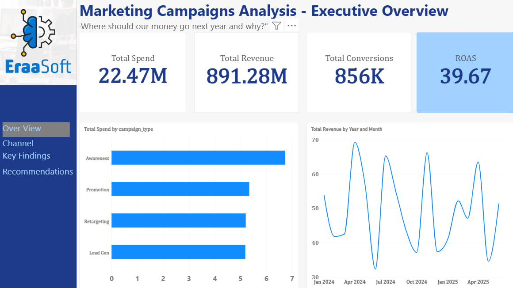
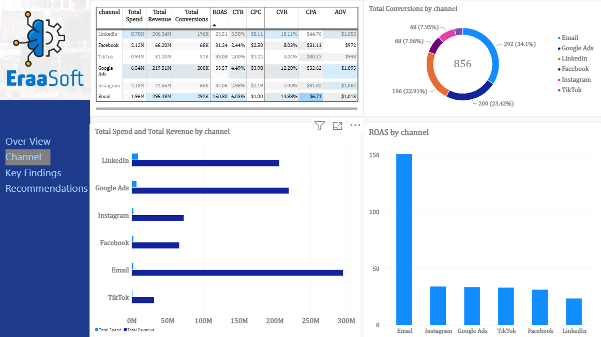
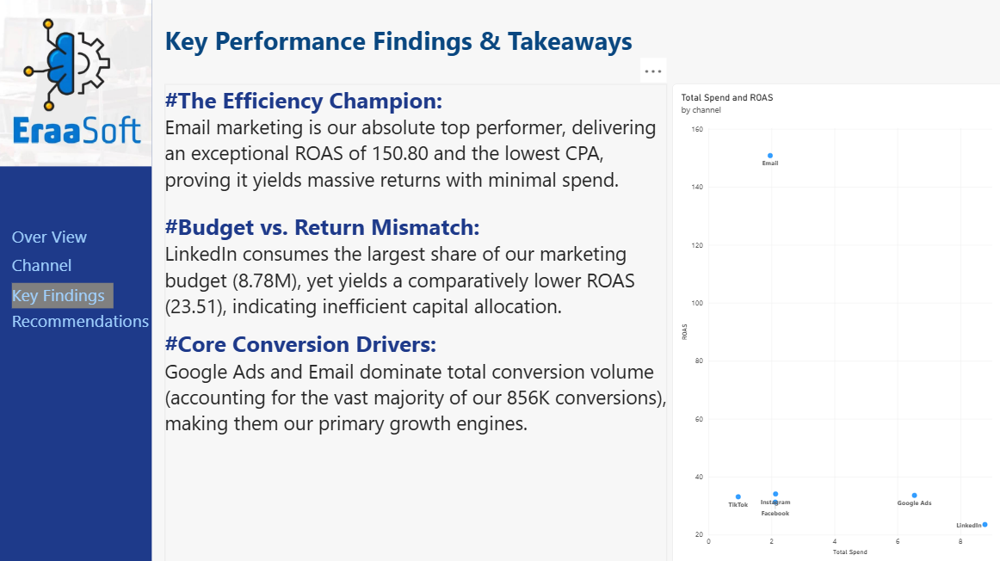
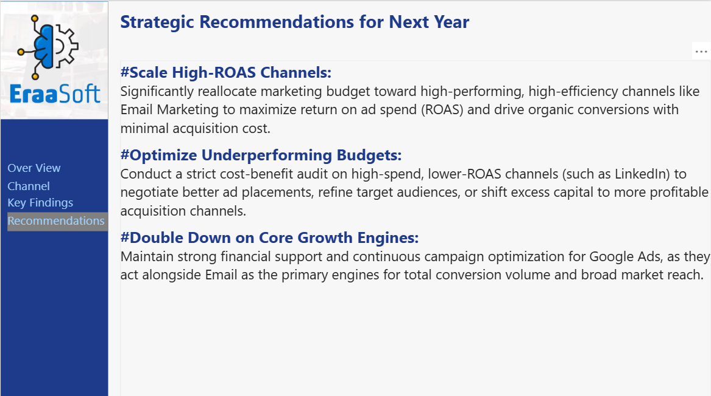

# Power-BI-marketing-campaigns-analysis
An executive Power BI dashboard analyzing marketing campaign performance, channel efficiency, ROAS, and budget allocation.

# 📊 Marketing Campaigns Analysis - Executive Dashboard

## 📌 Executive Summary
This Power BI project provides an end-to-end performance analysis of marketing campaigns across multiple channels (Email, Google Ads, LinkedIn, Facebook, Instagram, TikTok). The dashboard transitions from high-level KPIs to channel-specific deep dives, key efficiency findings, and strategic recommendations for upcoming budget allocations.

---

## 🔑 Key Metrics & Highlights
- **Total Spend:** $22.47M
- **Total Revenue:** $891.28M
- **Total Conversions:** 856K
- **Overall ROAS:** 39.67x
- **Top Performer:** **Email Marketing** achieved an extraordinary **150.80 ROAS** with the lowest CPA ($6.71).
- **Budget Mismatch:** **LinkedIn** consumed the largest budget share ($8.78M) while yielding a lower relative ROAS (23.51x).

---

## 🖼️ Dashboard Preview

### 1. Executive Overview

### 2. Channel Performance

### 3. Key Findings

### 4. Strategic Recommendations

---

## 🛠️ Tools & Skills Demonstrated
- **Power BI Desktop:** Multi-page reporting, custom navigation buttons, visual formatting.
- **Data Modeling & Analytics:** Calculating ROAS, CPA, CVR, CTR, and AOV metrics.
- **Data Storytelling:** Translating complex data into executive findings and strategic business recommendations.

---

## 👤 Author
- **Name:** Ahmed Altabie
- **LinkedIn:** [Ahmed Altabie](https://www.linkedin.com/in/ahmed-altabie/)
